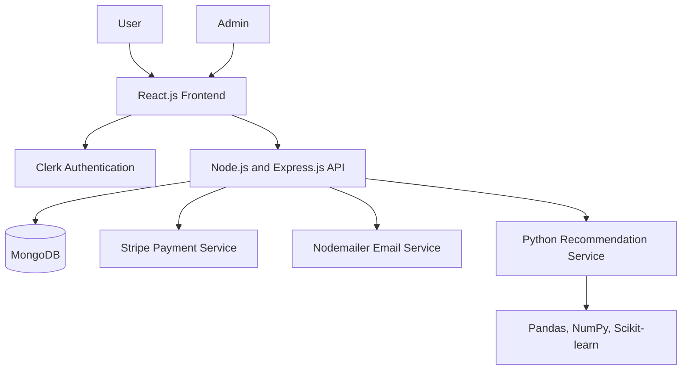
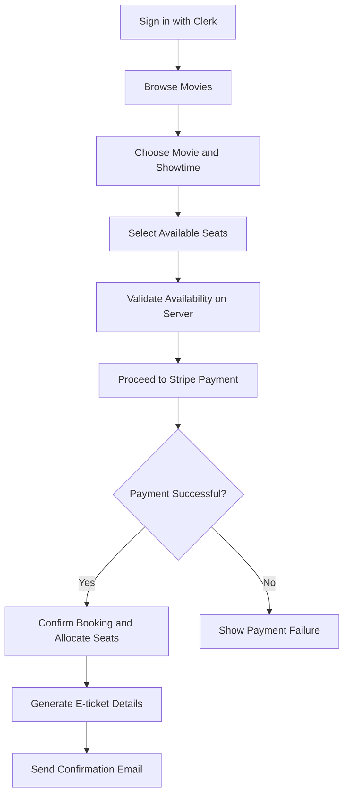

🎬 Movie Ticket Booking Web Application

<strong>{=html}A full-stack movie ticket booking platform with secure
authentication, seat selection, AI-powered recommendations, and online
payments.</strong>{=html}

{=html}
{=html}
{=html}
{=html}

📌 Overview

The Movie Ticket Booking Web Application is a full-stack platform
that streamlines the process of discovering movies, choosing showtimes,
selecting seats, and purchasing tickets online. It combines a React.js
frontend with a Node.js and Express.js backend, MongoDB for data
persistence, Clerk for authentication, and Stripe for payment
processing.
The application also includes a Python-based movie recommendation engine
and automated booking confirmations to deliver a more personalized and
convenient booking experience.

✨ Features

👤 User Experience
- Secure sign-up and sign-in powered by Clerk.
- Browse available movies and show schedules.
- Select seats for a chosen showtime.
- Complete ticket purchases through the Stripe payment flow.
- Receive booking confirmation emails and e-ticket details after
  successful booking.
- Discover movies through an AI-driven recommendation engine.
- 
🎟️ Seat Booking
- Interactive seat selection for showtime-based bookings.
- Booking workflow connected to backend APIs and MongoDB.
- Seat allocation and booking status management.
- Seat availability should be revalidated on the server during booking
  to help prevent duplicate reservations.
  
🤖 AI Movie Recommendations
- Python-based recommendation service.
- Data processing and recommendation logic using Pandas, NumPy, and
  Scikit-learn.
- Helps users discover movies based on the recommendation model
  implemented in the project.
  
💳 Online Payments
- Stripe integration for movie-ticket transactions.
- Backend support for payment-related operations.
- Keep Stripe secret keys on the server and verify payment status
  before confirming a booking.
  
📧 Booking Notifications
- Nodemailer-based email confirmation workflow.
- Booking details and e-ticket information sent to users after
  successful booking, according to the configured email workflow.
  
🛠️ Admin Dashboard
- Manage movie listings.
- Manage show schedules.
- Manage seat allocations and booking information.
- Admin functionality protected by authentication and role-based
  authorization.
  
🧰 Tech Stack
  Technology                          Purpose
  React.js                            Frontend user interface
  Node.js                             Backend JavaScript runtime
  Express.js                          REST API framework
  MongoDB                             Database for application data
  Clerk                               Authentication and identity
                                      management
  Role-based access control           Protect user and admin
                                      functionality
  Stripe                              Online payment processing
  Python                              Recommendation service
  Pandas                              Data processing
  NumPy                               Numerical operations
  Scikit-learn                        Recommendation algorithms and
                                      machine-learning utilities
  Nodemailer                          Email confirmations
  Git & GitHub                        Version control and collaboration
  
🏗️ Architecture

🔄 Booking Workflow

📁 Project Structure
The exact structure depends on your repository. A typical layout for
this stack may look like:
movie-ticket-booking/
├── client/                  # React.js frontend
├── server/                  # Node.js and Express.js backend
├── recommendation-service/  # Python recommendation engine, if separate
├── README.md
└── .gitignore
Update this section to match your actual folders and filenames before
publishing.

🚀 Getting Started
Prerequisites
- Node.js and npm
- MongoDB (local instance or hosted database)
- Clerk application and API keys
- Stripe account and test API keys
- Python 3 and pip for the recommendation service
- SMTP credentials for Nodemailer email delivery
- 
1. Clone the repository
Replace the placeholder URL with your actual GitHub repository URL.
git clone https://github.com/<your-username>/<your-repository>.git
cd <your-repository>

2. Configure the backend
Navigate to the backend directory and install dependencies:
cd server
npm install
Create a .env file using the exact environment variable names expected
by your backend. Example values:
PORT=5000
MONGODB_URI=your_mongodb_connection_string
STRIPE_SECRET_KEY=sk_test_your_stripe_secret_key
CLERK_SECRET_KEY=your_clerk_secret_key
CLIENT_URL=http://localhost:5173
If your application uses Clerk middleware or Stripe webhook
verification, configure all additional variables required by your code.
Never commit real secrets to GitHub.
Start the backend using the script defined in server/package.json. If
a dev script exists:
npm run dev

4. Configure the frontend
Open a second terminal:
cd client
npm install
For a Vite-based React app, frontend variables may look like:
VITE_CLERK_PUBLISHABLE_KEY=your_clerk_publishable_key
VITE_API_URL=http://localhost:5000
VITE_STRIPE_PUBLISHABLE_KEY=pk_test_your_stripe_publishable_key
Use the environment-variable prefix required by your actual frontend
build tool and the variable names referenced in your source code. Only
public keys belong in frontend configuration; never expose secret keys.
Run the frontend using the script in client/package.json, commonly:
npm run dev

6. Configure the recommendation service
If the Python recommendation engine is a separate service, create and
activate a virtual environment, then install the dependencies used by
the project.
python -m venv venv
Windows PowerShell:
.\venv\Scripts\Activate.ps1
Install the packages:
pip install pandas numpy scikit-learn flask
Start the service using its actual entry-point file and configured port.
For example, if it is a Flask application:
python app.py
Adjust the command and dependencies to match your implementation.

🔐 Security Notes
- Keep Stripe secret keys, Clerk secret keys, database credentials,
  and SMTP passwords out of source control.
- Configure Clerk's authorized roles and enforce admin permissions on
  the backend, not only in the UI.
- Validate booking inputs and recheck seat availability on the server.
- Confirm bookings only after the backend verifies successful payment.
- Verify Stripe webhook signatures if webhooks are used.
- Store environment files in .gitignore and provide a sanitized
  .env.example instead.
  
🧪 Testing Checklist
- [ ] User sign-up, sign-in, and sign-out.
- [ ] User and admin permission checks.
- [ ] Movie listings and showtime selection.
- [ ] Seat selection and duplicate-booking prevention.
- [ ] Successful and failed Stripe test payments.
- [ ] Booking confirmation and e-ticket details.
- [ ] Email delivery and error handling.
- [ ] Recommendation service response.
- [ ] Responsive layout on desktop and mobile.
- [ ] 
🌟 Future Enhancements
- Movie ratings and reviews.
- Booking history and ticket cancellation.
- QR codes for e-ticket validation.
- More advanced recommendation models.
- Real-time seat updates across concurrent users.
- Automated tests and CI/CD deployment.
- 
👨‍💻 Author
Mohit Kumar
- GitHub: @Mohitkr09
- 
📄 License
No license is specified in this README. Add a LICENSE file if you want
to define how others may use, modify, and distribute the project.
